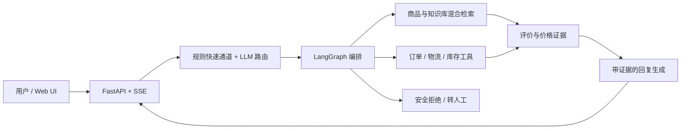

# 织语 WeaveTalk

[](https://github.com/Aleax9291/weavetalk/actions/workflows/ci.yml)
[](LICENSE)
[](https://www.python.org/)

织语是一个面向家纺电商场景的客服与导购一体化 Agent。它把多意图路由、混合检索、商品推荐、评价证据聚合、订单查询、安全防护和转人工串成一条可运行、可评估的完整链路。

> 本仓库用于学习、作品展示和 Agent 工程实验。商品、评价、订单与物流信息均由脚本合成，不对应真实消费者或店铺。

## 主要能力

- 规则快速通道与 LLM 多标签路由，支持投诉、攻击、订单、政策和导购等场景
- BM25 + 本地向量模型 + RRF 的混合检索，向量层不可用时自动降级
- 单品、多品类和套装导购，结合规格、预算、库存与评价证据
- 订单、物流和库存的 mock 工具调用
- 外部数据降权包裹、提示注入识别与确定性转人工
- SSE 流式接口和轻量网页演示
- 开发集、holdout、多轮采样与 LLM judge 组合评估

## 架构



## 快速开始

### 1. 准备环境

- Python 3.13+
- [uv](https://docs.astral.sh/uv/)
- 一个支持 OpenAI Chat Completions 协议的模型 API 密钥

```bash
git clone https://github.com/Aleax9291/weavetalk.git
cd weavetalk
uv sync --locked
```

### 2. 配置模型

复制示例配置并填写自己的密钥：

```bash
cp .env.example .env
```

Windows PowerShell：

```powershell
Copy-Item .env.example .env
```

| 变量 | 必填 | 说明 |
|---|---:|---|
| `LLM_BASE_URL` | 是 | OpenAI 兼容 API 地址 |
| `LLM_API_KEY` | 是 | API 密钥，只保存在本地 `.env` |
| `LLM_MODEL` | 是 | 主生成模型 |
| `ROUTER_MODEL` | 否 | 路由模型；为空时复用主模型 |
| `EMBEDDING_MODEL` | 否 | 预留的向量模型配置 |

### 3. 启动

```bash
uv run uvicorn app.main:app --reload
```

浏览器访问 <http://127.0.0.1:8000>，健康检查位于 <http://127.0.0.1:8000/healthz>。

首次启动会尝试加载 `BAAI/bge-small-zh-v1.5`。如果模型不可用，检索会自动退化为纯 BM25，不影响基础演示。

## 测试与质量检查

```bash
uv run ruff check .
uv run pytest
```

GitHub Actions 会在每次 push 和 pull request 时执行相同检查。

## 评估

先启动服务，再运行开发集：

```bash
uv run python scripts/run_eval.py --tag local --runs 1
```

多轮稳定性评估示例：

```bash
uv run python scripts/run_eval.py --tag local-3r --runs 3
```

当前公开的定版结果：

| 评测集 | 平均通过率 | 3/3 一致通过 | 稳定失败 |
|---|---:|---:|---:|
| 开发集（92 题） | 96.7% | 93.5% | 1 |
| Holdout（40 题） | 90.8% | 82.5% | 0 |

- [开发集定版报告](eval/report-v8-final.md)
- [Holdout 三轮报告](eval/report-holdout-1.2-3r.md)
- [评估方法论](eval/评估方法论.md)

LLM 生成与 judge 判定存在随机性，复跑结果可能波动；报告中的数字是指定模型和当时配置下的实验结果，不代表生产 SLA。

## 项目结构

```text
app/
  agent/          # 状态、路由、提示词、工具和 LangGraph
  api/            # 对话与 mock API
  data/           # 合成商品、评价、订单和知识库
  services/       # LLM、检索与安全封装
  static/         # 演示页面
eval/             # 评测集、定版报告和方法论
scripts/          # 数据生成、评估与冒烟测试
tests/            # 不依赖外部模型的自动化测试
```

## 安全与数据说明

- 不要提交 `.env`、真实 API 密钥、真实订单、聊天日志或客户数据。
- 本项目的会话保存在进程内存中，重启即清空，仅适合单机演示。
- mock 接口没有业务鉴权；若接入真实订单系统，必须在服务端校验用户身份和资源归属。
- 本项目不包含生产级限流、持久化、审计、内容安全或成本控制。公开部署前应补齐这些能力。
- 安全问题请按 [SECURITY.md](SECURITY.md) 私密报告，不要在公开 Issue 中披露密钥或漏洞细节。

## 贡献

欢迎提交 Issue 和 Pull Request。开始前请阅读 [CONTRIBUTING.md](CONTRIBUTING.md) 与 [CODE_OF_CONDUCT.md](CODE_OF_CONDUCT.md)。

## 许可证

本项目采用 [MIT License](LICENSE)。
